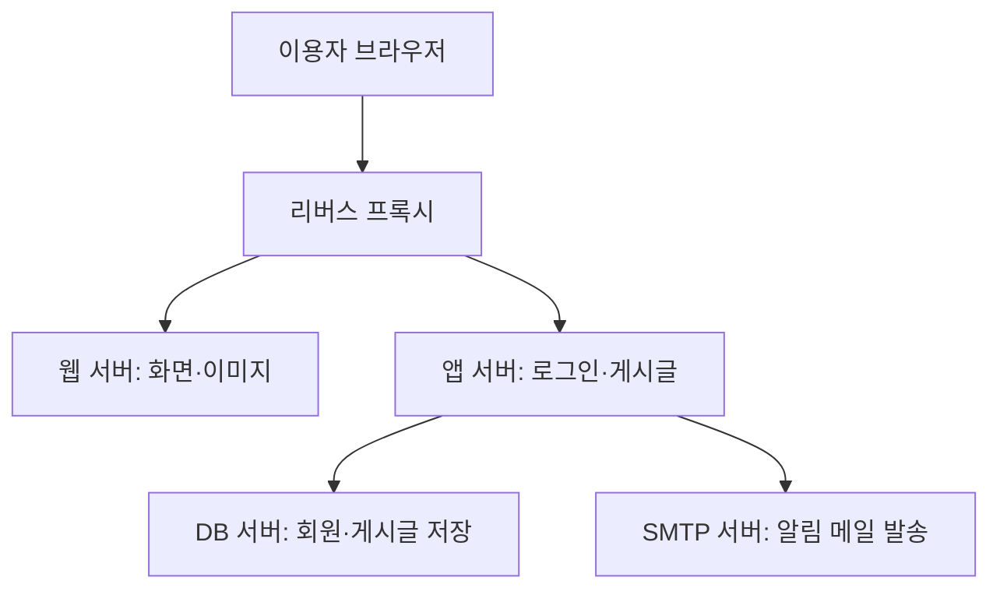

# 그림으로 배우는 웹 구조 Web Technology
*teacher: 스이카님*
---

- Ch 1. 웹 기술의 기본 -10/7
- Ch 2. 웹의 독자적인 구조 -10/14
- Ch 3. 웹을 지탱하는 구조 - 10/21
- Ch 4. 웹 보급과 확산
- Ch 5. 웹과 다른 시스템
- Ch 6. 클라우드와의 관계
- Ch 7. 웹 사이트의 개설에 즈음하여
- Ch 8. 웹 시스템의 개발
- Ch 9. 보안과 운용

## 1. 웹 기술의 기본

# 1장. 웹 기술의 기본

- 인터넷 = 네트워크 인프라 = 도로망 = 데이터가 이동할 수 있는 물리적인 통로
- 웹 = 인터넷(도로망)을 통해서 데이터를 주고받기 위한 구조
- 웹 사이트 구성 = 디바이스(브라우저)+인터넷+웹서버
    - 브라우저: 하이퍼텍스트를 사람의 눈으로 보기 쉽게 표시해준다.
    
- 웹 앱의 구성: 웹 서버+AP서버+DB서버

Q: AWS를 빌리면 위 그림과 같이 작동하는 웹서버에 해당하나요?

> AWS에서 빌린 컴퓨터를 웹 서버로 사용할 수 있습니다.
> AWS는 여러 클라우드 서비스를 제공하고, 그중 EC2는 인터넷으로 접속해서 사용하는 가상 컴퓨터를 빌리는 서비스예요. 여기에 웹 서버 프로그램과 웹사이트 코드를 설치하고 설정하면 웹 서버로 작동합니다.
 
Q: 그림 1-4 웹 시스템의 서버가 여러개가 나오는데 물리적으로 실제로 분리되어서 4개가 있는것인지? 아니면 개념적으로 4개의 공간으로 나누어 두었고 물리적으로는 1개의 서버가 있는건지?

>둘 다 가능합니다. 그림의 상자 개수만으로 실제 컴퓨터 대수를 판단할 수는 없어요.
> 여기서 ‘개념적으로 나눈다’는 것은 저장 공간을 폴더 네 개로 나눈다는 의미보다는, 서로 다른 역할의 프로그램을 실행한다는 의미에 가까워요.
> 또한 AWS에서 가상 서버를 4개 빌렸다고 실제 컴퓨터 4대를 각각 독점하는 것은 아닙니다. 여러 가상 서버가 같은 물리 컴퓨터의 자원을 나눠 사용할 수 있어요.

- URL:스키마(”http://”)호스트명(www.)+도메인명(youngin.com)+경로명(/about/index/html)
- 도메인명은 유일한 쌍을 이루는 IP주소를 갔고 있다.

| 구성 방식 | 실제 모습 |
|---|---|
| 컴퓨터 한 대에서 함께 실행 | 웹·AP·DB 등의 프로그램을 한 컴퓨터에 설치 |
| 가상 컴퓨터 여러 대로 분리 | 한 물리 컴퓨터 안에 가상 컴퓨터 여러 개를 만들어 각각 실행 |
| 물리 컴퓨터 여러 대로 분리 | 실제 컴퓨터를 여러 대 두고 역할을 나눠 실행 |

Q: 웹 서버 안에도 cpu, 그래픽카드, RAM이라는 개념이 있나요? 처리가 많고 복작한 경우에는 왜 웹 서버로 부터 분리해서 AP 서버, DB 서버 등을 사용해야하나요?
> 네. 웹 서버 프로그램이 실행되는 컴퓨터에도 CPU·RAM·저장장치가 필요합니다. 클라우드에서는 이 자원의 일부를 할당받아 사용해요. GPU는 선택 사항이며, 일반적인 웹사이트 운영에는 보통 필요하지 않습니다. AI 모델 실행이나 영상 처리 같은 작업에는 GPU를 사용하기도 해요.

| 부품 | 하는 일 |
|---|---|
| CPU | 프로그램 실행, 계산, 요청 처리 |
| RAM | 실행 중인 프로그램과 작업 데이터를 임시 보관 |
| SSD 등 저장장치 | 코드·파일·DB 데이터를 저장 |
| GPU | AI 연산·영상 처리 등 특정 계산을 가속 |

> 한 컴퓨터에서 모든 역할을 수행하면 웹·AP·DB 프로그램이 같은 CPU와 RAM을 나눠 씁니다. 예를 들어 복잡한 통계 계산이 CPU를 많이 사용하면, 같은 컴퓨터에서 처리하던 로그인이나 게시글 조회도 느려질 수 있어요.

> 서버를 분리하면 다음과 같이 대응할 수 있습니다.
> - 자원 확보: AP와 DB가 각각 사용할 CPU·RAM을 확보합니다.
> - 필요한 부분만 확장: 계산이 많으면 AP 서버를 늘리고, 데이터 처리가 문제면 DB 성능을 보강합니다.
> - 운영·보안 관리: AP를 수정하거나 재시작할 때 DB를 별도로 유지하고, DB에는 AP만 접속하도록 제한할 수 있습니다. 계층을 나누면 각 부분을 독립적으로 확장하고 관리하기 쉬워집니다. IBM
> 다만 반드시 분리해야 하는 것은 아닙니다. 작은 서비스는 한 대에서도 충분히 운영할 수 있어요. 같은 컴퓨터 안에서 역할만 나눈다고 전체 성능이 늘어나는 것도 아니므로, 실제 사용량과 관리 필요에 따라 분리합니다.

- 리퀘스트(요청): 브라우저가 웹 서버에 데이터를 요청하는 행위
- 응답: html, css, javascript 으로 요청에 응한다
- 랜더링: 브라우저가 응답을 적절한 형태로 처리해 화면에 표시하는 행위
- API: 백엔드가 제공하는 데이터 창구(문)다.
- API 예시: 애플리케이션을 통해 내 위치 정보를 웹 서버로 송신하여 그 구역의 날씨 정보를 수신

우리가 URL을 치면 DNS가 IP를 하나 던지고 그 주소로 이동한다.
처음에는 껍데기로 일단 이동을 하게 된다. 그 다음에 서버에서 데이터를 받아서 프론트 엔드에 뿌려주게 된다.

구분 동작으로 보면,

1. 우리가 URL을 치면 DNS가 IP를 하나 던지고 그 주소로 이동한다.
2. 처음에는 껍데기로 이동을 하게 된다.
3. 프론트페이지(껍데기)가 api를 호출 한다. *호출: 정보를 요청하는 행위*  json형태로 데이터를 받는다.
4. AP서버는 DB에 정보를 호출하고
5. 정보를 받아 프론트페이지로 가져오게된다.

ISP: 인터넷 공급 업자: KT, LGU+ 같은 곳
IX: ISP들이랑 해저케이블(부산, 서해안)로 

우리집에서 ISP 타고 IX 타고 해저케이블 타고 일본 IX 타고 ISP 타서 
IX들을 모아서 ~

*사실 노드(통신 전공쪽 개념)란 개념이 그 사이에 추가적으로 있다.*

## 2. 웹의 독자적인 구조

브라우저에서 서버로 요청을 한다. 

- GET 방식: 서버에 있는 데이터를 조회할 때 사용. (예: 게시글 보기, 상품 검색)
- POST 방식: 서버에 데이터를 보내 등록하거나 처리를 요청할 때 사용. (예: 회원가입, 게시글 작성)

쿠키: 서버에서 발행해 주는 입장권 같은 것. 예를들어 로그인하면 서버에서 09akz라는 입장권을 주고 이거로 입장하고 나오고 한다. 이러면 좋은점은 매번 사용자 정보를 안가져와도 됨?

web전용 프레임워크(로그인은 이렇게 반환하고, 이메일은 이거하고 ) = php, 
react도 자바스크립트

- 웹페이지는 자바스크립트로 고칠 수 있다.

- java, php = 대표적인 백앤드 기술 -> 이런것은 프레임워크(뼈대)가 있어서 코드를 조금만 하면된다. 기본적인 규칙들이 다 코딩되어있다.
- JDK:자바 개발 키트
- JVM:자바 가상 머신 -> 가상서버를 띄우는거라 위도우나 리눅스에서도 둘다 돌아감 

## 3. 웹을 지탱하는 구조

- TCP/IP: 통신할때 데이터 주고 받는 규칙
- 데이터 캡슐화를 통해 데이터가 애플리케이션-> 트랙스포트->인터넷->네트워크 인터페이스(wifi까지 물림) -> 이동 -> 역으로 풀어서 데이터 전달
- IP주소는 네트워크에서 통신 상대를 식별하기 위해, MAC주소는 네트워크 내에서 기계에 붙은 지문(식별 목적) 사용
- 고정 IP는 보통 시스템에 붙여야하는 경우에 많이 사용한다. 예를들어 서버1,2,3이 정해진 IP만 허용하게 하는 것이다. 이것은 어찌 보면 보안에 취약할 수 있기 때문에 중요한 자료는 안둔다.
- 유동 IP는 보통 서비스를 하는곳에서 사용하게 된다.

서버의 종류는 여러가지다. 

- 프록시 서버: 원래 클라이언트 PC에서 본 서버로 바로 요청을 하는 구조였다면, 프록시 서버는 이 중간에 존재하여 역할을 하게 된다. 
1. 프록시 서버는 여러개 둘 수 있고 분산처리를 하여 처리 속도를 올려주는 기능도 한다.
2. 본 서버 접속의 방패막이로 사용된다. 요청과 응답을 중계하기 때문에, 설정에 따라 접근을 통제한다. 특정 사이트 접속 차단, 허용된 요청만 내부 앱에 전달

*프록시 종류별로 보면:*
*- 포워드 프록시: 학교·회사 직원이 접속할 수 있는 외부 사이트를 제한할 수 있어.*
*- 리버스 프록시: 홈페이지로 들어오는 요청에서 특정 IP를 차단하거나, 요청 횟수를 제한할 수 있어.
다만 프록시를 설치하기만 하면 공격이 자동으로 차단되는 건 아니야. 접근 제한 규칙이나 보안 기능을 설정해야 해. 실제 서비스에서는 방화벽·리버스 프록시·WAF를 함께 사용하기도 해.*

- HTTP는 정부나 크롬에서 막고 있고 요즘은 HTTPS다. HTTP가 SSL인증, TLS인증서를 통해서 보안에 대한 자격증을 취득해서 HTTPS를 붙이는 것이라고 볼 수 있다.
- HTTP 기본 포트는 80이고 보통 생략된다. 도메인은 IP:포트번호 까지 포함하게 된다.
  * naver.com이라는 도메인 1개를 발급받았다면, shopping.naver.com을 만드는 등 앞에 다른 주소를 두어 아예 다른 서비스를 운영할수 있다.*

## 클라우드: aside, ego LITE가 유명하다.

---
### GPT 정리

## 서버 종류 한눈에 정리

서버는 **다른 컴퓨터나 프로그램의 요청을 받아 데이터·기능·서비스를 제공하는 컴퓨터 또는 프로그램**이다.

예를 들어 브라우저가 홈페이지를 요청하면 웹 서버가 응답하고, 회원정보를 조회하면 데이터베이스 서버가 저장된 정보를 제공한다.

서버의 종류는 다음 두 기준으로 나누면 이해하기 쉽다.

| 구분 기준 | 핵심 질문 | 예시 |
| --- | --- | --- |
| 역할 | 어떤 일을 하는가? | 웹 서버, DB 서버, 프록시 서버, SMTP 서버 |
| 운영 방식 | 어디에서 어떤 자원을 사용해 운영하는가? | 직접 운영, 전용 서버, VPS, 클라우드, 서버리스 |

> 웹 서버와 VPS는 서로 다른 분류 기준이다. VPS 한 대에서 웹 서버·앱 서버·DB 서버를 함께 실행할 수 있다.

## 1. 역할에 따른 서버 종류

| 종류 | 하는 일 | 쉬운 예시 |
| --- | --- | --- |
| **웹 서버** | HTTP·HTTPS 요청을 받아 웹페이지·이미지·CSS 같은 자료를 전달한다. | 홈페이지 화면과 이미지 보여주기 |
| **애플리케이션 서버** | 서비스의 규칙에 따라 요청을 처리하고 기능을 실행한다. | 로그인 검증, 게시글 작성, 결제 처리 |
| **데이터베이스(DB) 서버** | 데이터를 저장·검색·수정·삭제한다. | 회원정보·게시글·결제 내역 관리 |
| **파일 서버** | 파일을 저장하고 여러 이용자가 접근하도록 제공한다. | 부서 공용 문서함, 파일 업로드·다운로드 |
| **프록시 서버** | 이용자와 다른 서버 사이에서 요청과 응답을 중계한다. | 외부 사이트 접속 통제, 내부 앱으로 요청 전달 |
| **메일 서버** | 이메일의 전달·보관·조회를 담당한다. SMTP·POP3·IMAP 등이 역할을 나눠 맡는다. | 회사 이메일 서비스 |
| **DNS 서버** | 도메인 이름에 연결된 IP 주소 등 DNS 정보를 제공한다. | example.com에 해당하는 IP 주소 조회 |
| **AI 서버** | AI 모델을 실행해 추론이나 학습을 수행한다. | 챗봇 답변, 음성인식, 이미지 생성 |
| **게임 서버** | 여러 이용자의 게임 상태와 상호작용을 관리한다. | 같은 게임방의 위치·점수·진행 상황 관리 |

웹 서버와 애플리케이션 서버의 경계는 구현에 따라 겹칠 수 있다. 하나의 프로그램이 정적 파일 전달과 앱 기능 처리를 함께 수행하기도 한다.

## 2. 프록시 서버: 요청과 응답을 중계하는 서버

**프록시(Proxy)는 다른 서버와 통신할 때 중간에서 요청과 응답을 대신 전달하는 역할**이다.

프록시는 크게 **포워드 프록시**와 **리버스 프록시**로 구분한다. 아래 설명은 웹 통신에서의 대표적인 사용 방식이다.

| 구분 | 포워드 프록시 | 리버스 프록시 |
| --- | --- | --- |
| 누구 쪽을 대신하는가? | 서비스를 이용하는 클라이언트 쪽 | 서비스를 제공하는 서버 쪽 |
| 주로 배치하는 위치 | 이용자와 외부 인터넷 사이 | 외부 이용자와 내부 서비스 사이 |
| 대표 목적 | 외부 접속 통제, 접근 기록, 캐시 | 요청 분배, HTTPS 처리, 내부 서버 연결 |
| 쉬운 예시 | 교직원 PC의 외부 웹사이트 접속을 학교 프록시를 통해 처리 | 홈페이지로 들어온 요청을 내부 앱 서버로 전달 |

리버스 프록시는 설정에 따라 다음 기능을 수행할 수 있다.

- **요청 분배**: 여러 앱 서버에 요청을 나눠 전달한다.
- **경로별 연결**: 홈페이지 요청과 API 요청을 서로 다른 서비스로 보낸다.
- **HTTPS 처리**: 인증서와 암호화 연결 처리를 맡는다.
- **캐시**: 저장해 둔 응답을 재사용해 내부 서버의 부담을 줄인다.

> 프록시를 설치했다고 모든 기능이 자동으로 적용되는 것은 아니다. 목적에 맞는 설정이 필요하다.

## 3. 메일 서버: SMTP·POP3·IMAP 구분

SMTP·POP3·IMAP은 **이메일과 관련된 통신 규칙인 프로토콜**이다. 각 프로토콜을 처리하는 프로그램을 SMTP 서버, POP3 서버, IMAP 서버라고 부른다.

### 3.1. 역할 비교

| 종류 | 전체 이름 | 핵심 역할 | 쉬운 비유 |
| --- | --- | --- | --- |
| **SMTP 서버** | Simple Mail Transfer Protocol | 발송할 메일을 접수하고 다른 메일 서버로 전달한다. | 우체국의 편지 접수·배송 |
| **POP3 서버** | Post Office Protocol Version 3 | 서버에 도착해 보관된 메일을 이용자의 기기로 가져오게 한다. | 우편함의 편지를 집으로 가져오기 |
| **IMAP 서버** | Internet Message Access Protocol | 서버의 메일함에 접근해 메일·폴더·읽음 상태 등을 관리하게 한다. | 여러 기기에서 같은 우편함 확인하기 |

### 3.2. SMTP 서버

SMTP는 **메일을 보내고 메일 서버 사이에서 전달할 때** 사용한다.

예를 들어 홈페이지에서 가입 인증 메일을 보내거나, 메일 앱에서 작성한 편지를 발송할 때 사용한다.

**받는 쪽 메일 서버도 다른 서버가 보낸 메일을 SMTP로 수신한다.** 따라서 SMTP를 단순히 “수신과 무관한 프로토콜”이라고 이해하면 부정확하다. 사용자가 보관된 메일을 읽기 위해 가져오는 역할은 POP3·IMAP이 담당한다.

### 3.3. POP3 서버

POP3는 **서버에 보관된 받은 메일을 기기로 가져오는 데** 사용한다.

가져온 메일을 기기에서 보관하며 읽는 방식에 사용할 수 있다. 서버에 원본을 남길지는 메일 앱과 서비스 설정에 따라 달라진다.

> POP3로 메일을 가져왔다고 서버의 메일이 무조건 즉시 삭제되는 것은 아니다.

### 3.4. IMAP 서버

IMAP은 **서버에 있는 메일함을 여러 기기에서 확인하고 관리하는 데** 사용한다.

예를 들어 PC에서 읽은 메일을 휴대폰에서도 읽음 상태로 확인하거나, 한 기기에서 옮긴 폴더 상태를 다른 기기에서도 확인하는 방식이다. 메일 앱은 오프라인 확인을 위해 일부 내용을 기기에 저장할 수도 있다.

| 비교 항목 | POP3 | IMAP |
| --- | --- | --- |
| 기본 접근 방식 | 메일을 기기로 가져오기 중심 | 서버의 메일함 접근·관리 중심 |
| 서버 원본 보관 | 앱·서비스 설정에 따라 달라짐 | 보통 서버에 보관하며 관리 |
| 폴더·읽음 상태 동기화 | 메일함 전체 상태 동기화 기능이 제한적 | 여러 기기의 메일함 상태 동기화 지원 |
| 이해하기 좋은 상황 | 받은 메일을 특정 기기에 내려받아 보관 | PC·휴대폰 등에서 같은 메일함 사용 |

### 3.5. 대표적인 메일 포트

**포트는 한 서버 안에서 어떤 서비스에 연결할지 구분하는 번호**다. 아래는 대표적인 기본 포트이며, 실제 연결은 제공업체의 안내를 따른다.

| 서비스 | TCP 포트 | 의미 |
| --- | --- | --- |
| SMTP 서버 간 전달 | 25 | 메일 서버끼리 메일을 전달할 때 사용 |
| SMTP 발송 접수 | 587 | 이용자의 메일 앱·서비스가 발송할 메일을 제출할 때 사용. STARTTLS로 암호화 연결 전환 가능 |
| SMTP 발송 접수 + TLS | 465 | 연결 시작부터 TLS를 사용하는 메일 발송 접수 |
| POP3 | 110 | POP3 기본 포트. 암호화 여부는 설정·지원 방식에 따라 달라짐 |
| POP3 + TLS | 995 | 연결 시작부터 TLS를 사용하는 POP3 |
| IMAP | 143 | IMAP 기본 포트. 암호화 여부는 설정·지원 방식에 따라 달라짐 |
| IMAP + TLS | 993 | 연결 시작부터 TLS를 사용하는 IMAP |

**TLS는 통신을 암호화하는 기술**이다. 587번 포트에서는 STARTTLS를 통해 TLS 연결로 전환할 수 있고, 465·995·993번 포트에서는 연결 시작부터 TLS를 사용한다. [메일 TLS 표준: RFC 8314](https://www.rfc-editor.org/rfc/rfc8314.html)

## 4. 운영 방식에 따른 서버 종류

아래 분류는 서로 완전히 분리되어 있지 않다. 특히 **VPS는 가상화 방식에 가깝고, 클라우드는 자원을 제공·관리하는 방식에 가깝다.**

| 종류 | 의미 | 쉬운 비유 |
| --- | --- | --- |
| **직접 운영하는 서버** | 내 PC나 보유 장비에서 서버 프로그램을 실행한다. 네트워크·전원·유지보수를 직접 관리한다. | 내 건물에서 가게 운영 |
| **전용 서버** | 물리적인 서버 한 대를 한 이용자가 전용으로 사용한다. | 건물 한 채 통째로 임대 |
| **VPS·가상 서버** | 물리 서버의 자원을 가상화해 독립된 서버 환경으로 나눠 사용한다. | 건물 안 사무실 한 칸 임대 |
| **클라우드 서버** | 제공업체의 컴퓨팅 자원을 관리 화면이나 API로 생성·조절하며 사용한다. | 필요에 따라 공간을 늘리고 줄여 임대 |
| **서버리스** | 제공업체가 서버 운영을 맡고, 이용자는 주로 코드·기능을 배포해 실행한다. | 시설 운영은 맡기고 업무 수행에 집중 |

- 클라우드에서 VPS와 같은 가상 서버를 만들어 사용할 수 있다.
- 클라우드를 사용해도 운영체제와 앱 관리를 이용자가 맡는 경우가 있다.
- 서버리스도 실제 서버에서 실행되며, 관리 책임의 더 많은 부분을 제공업체가 맡는다.
- AI 서버를 반드시 GPU로만 구성하는 것은 아니다. 모델과 작업량에 따라 CPU로도 실행할 수 있다.

## 5. 예시: AI 동아리 홈페이지의 서버 구성

다음은 역할을 나눠 표현한 **구성 예시**다.

| 이용자의 행동 | 담당 역할 |
| --- | --- |
| 홈페이지에 접속한다. | 리버스 프록시가 요청을 전달하고 웹 서버가 화면에 필요한 자료를 제공 |
| 로그인한다. | 앱 서버가 요청을 처리하고 필요한 회원정보를 DB 서버에서 조회 |
| 게시글을 작성한다. | 앱 서버가 작성 권한과 내용을 확인한 뒤 DB 서버에 저장 |
| 가입 인증 메일을 받는다. | 앱 서버가 SMTP 서버에 발송을 요청하고 메일 서버들이 수신자 쪽으로 전달 |
| 메일 앱에서 받은 메일을 확인한다. | 메일 서비스의 POP3 또는 IMAP 서버를 이용할 수 있음 |

**위 그림의 상자 하나가 반드시 컴퓨터 한 대를 의미하지는 않는다.**

작은 서비스는 VPS 한 대에서 리버스 프록시·웹 서버·앱 서버·DB 서버를 함께 실행할 수 있다. 하나의 프로그램이 웹 서버와 리버스 프록시 역할을 겸할 수도 있다. 메일 발송은 외부 SMTP 서비스를 연결하는 방식으로 구성할 수 있다.

가입 인증 메일처럼 **발송 기능만 필요한 홈페이지는 POP3·IMAP 서버를 직접 운영할 필요가 없다.** 받은 메일을 조회·처리하는 기능까지 만들 때 해당 역할을 검토하면 된다.

# Ch 4. 웹 보급과 확산, Ch 5. 웹과 다른 시스템, Ch 6. 클라우드와의 관계

웹서버를 구축하는 방법은 3가지가 있다.
1. 임대 서버 이용
2. 클라우드 서비스 이용
3. 자체 시설 내 구축

## 다음주 오라클 클라우드 무료 2개까지 빌릴 수 있어서 이를 통해 클라우드 서비스를 구축하고 서비스 올리는 것을 진행할 것이다.
